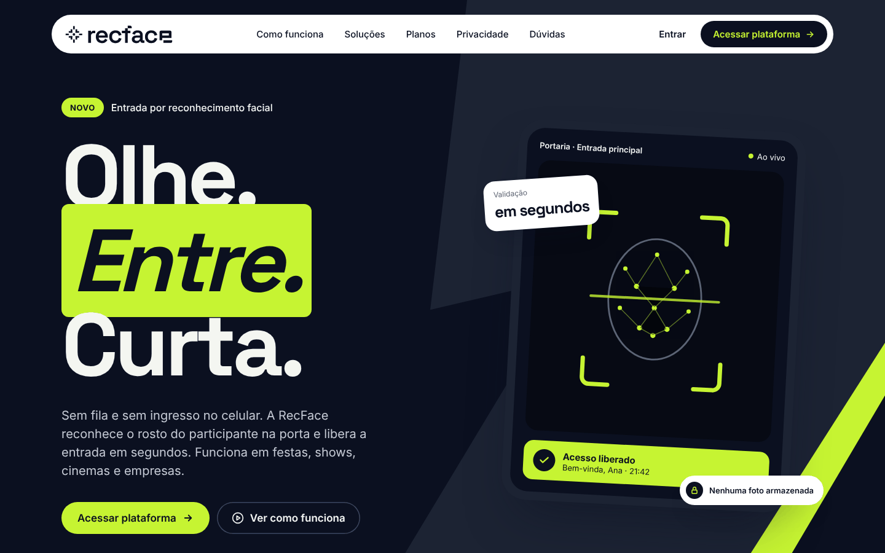
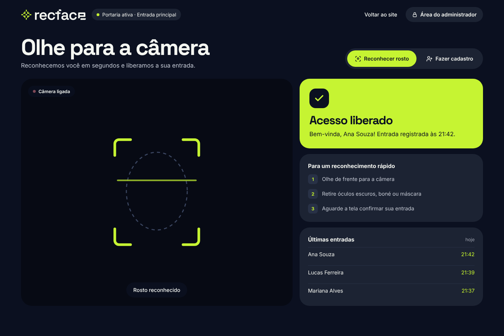
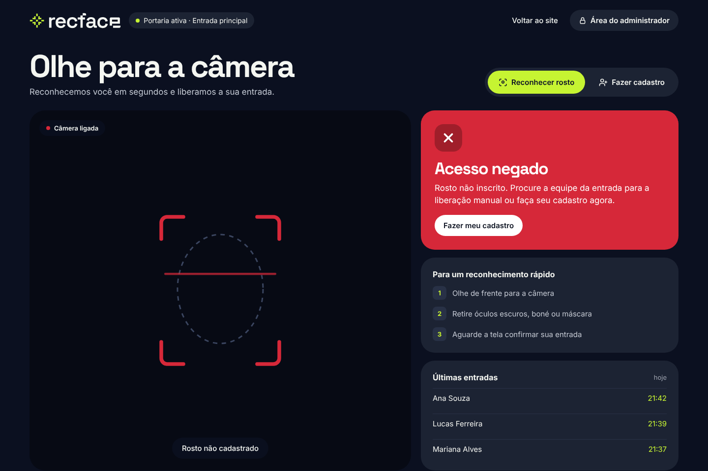
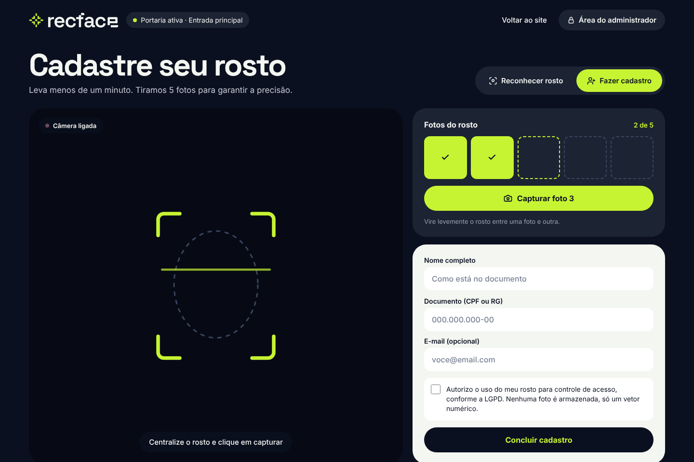
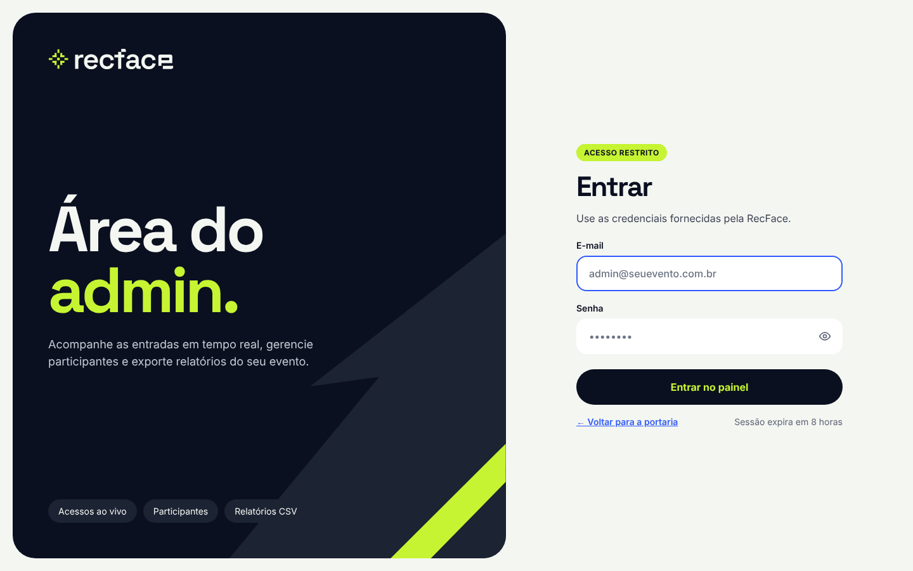
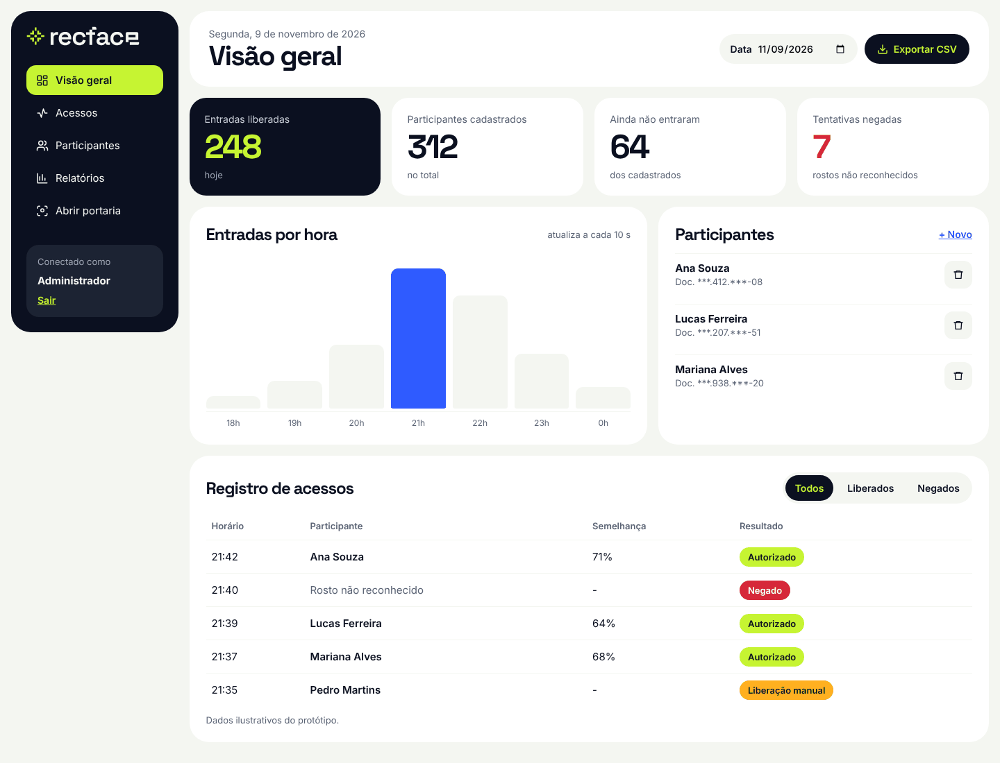
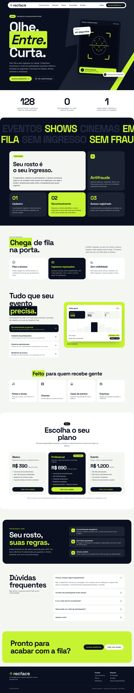
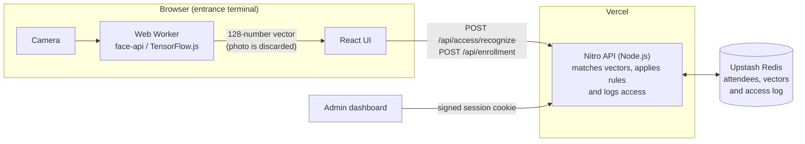

<p align="right">
  <a href="README.md"></a>
  <a href="README.pt-BR.md"></a>
</p>

<div align="center">

<picture>
  <source media="(prefers-color-scheme: dark)" srcset="public/brand/recface-logo-escuro.svg">
  
</picture>

### Look. Walk in. Enjoy.

**Face recognition access control that runs right in the browser.**
No queues, no tickets on your phone, and no one's photo is ever stored.

[](https://recface-umber.vercel.app)


</div>

<p align="center">
  
</p>

---

## Contents

- [About](#about)
- [Screens](#screens)
- [Features](#features)
- [Technical highlights](#technical-highlights)
- [Architecture](#architecture)
- [Tech stack](#tech-stack)
- [Running locally](#running-locally)
- [Project structure](#project-structure)
- [Limitations and next steps](#limitations-and-next-steps)
- [Team](#team)
- [License](#license)

---

## About

**RecFace** is an access control platform for **events, parties, movie theaters and companies**.
Attendees enroll their face once; at the entrance, they just look at the camera. The system recognizes them
in seconds, grants access and logs the date and time. Organizers follow everything on a live admin dashboard.

The project started as an Integrated Academic Project (TAI) in the **Computer Science program at PUC Minas**
(Brazil) and went through two major versions:

| Version | Context | What changed |
|---|---|---|
| **v1** (TAI 2) | Student attendance in computer labs | In-browser recognition engine, enrollment, dashboard and reports |
| **v2** (TAI 3) | RecFace company: event access | Marketing site, entrance terminal with enrollment and recognition, admin login, server-side face matching, LGPD consent, new visual identity |
| **v2.1** | Performance and quality | Recognition in a Web Worker, kiosk mode (PWA), model caching, automated UI and accessibility tests |

> **Privacy by default:** the photo is analyzed in the browser and discarded. Only a 128-number vector, which
> cannot be used to rebuild the face image, is sent to the server.

> **Note:** the product UI is in Brazilian Portuguese, since it was built for the Brazilian market.

---

## Screens

> Images from the high-fidelity prototype that guided the implementation (the data shown is illustrative).

### Entrance terminal: recognition and enrollment

| Access granted | Access denied |
|---|---|
|  |  |

| Face enrollment (5 photos + LGPD consent) |
|---|
|  |

### Admin area

| Login | Dashboard |
|---|---|
|  |  |

<details>
<summary><b>See the full home page</b></summary>
<br>

</details>

---

## Features

**For attendees**
- Guided enrollment in under a minute: 5 face photos, each validated on the spot, plus LGPD (Brazil's data protection law) consent
- Recognition at the entrance in seconds, with clear visual feedback: **granted**, **denied** or **already entered today**
- If the face is not recognized, the screen offers enrollment right away

**For organizers**
- Dashboard with today's entries refreshed every 10 seconds and an entries-per-hour chart
- Log of **every** attempt (granted, denied, duplicate and manual check-ins)
- Attendee management: search, manual check-in when recognition fails, and deletion that also erases the history
- Reports by period (7 days, 30 days or a custom range) with CSV export

**Business rules**
- One entry per person per day (Brasília time zone)
- Duplicate enrollment is rejected by document number **or** by facial similarity to someone already enrolled

---

## Technical highlights

| Challenge | Solution |
|---|---|
| **Biometric data privacy** | Face detection and vector extraction (128 dimensions) happen in the browser; no photo ever leaves the device or gets stored. |
| **Not exposing the face database** | In v1 the page downloaded every enrolled vector. In v2 matching moved to the server (`POST /api/access/recognize`), so vectors never leave it. |
| **UI freezing during analysis** | Recognition runs in a **Web Worker** with `OffscreenCanvas`, off the UI thread. Each frame is downscaled to 640 px first. There is an in-page fallback for browsers without support. |
| **Slow first inference** | GPU warm-up (~12 s) happens while the page loads, before the first face shows up. |
| **Heavy models (~12 MB)** | A service worker caches the models and the build; from the second visit on, the terminal opens without downloading everything again. |
| **Entrance hardware** | Kiosk mode/PWA: installable app, full screen and *Wake Lock* so the screen never sleeps. |
| **Accuracy vs. false positives** | Same person if the Euclidean distance between vectors is ≤ 0.5; enrollment is blocked if someone is within ≤ 0.42. The stored vector is the average of 5 captures. |
| **Dashboard security** | Session in an `httpOnly` cookie signed with HMAC-SHA256, valid for 8 hours; constant-time password comparison; login is disabled in production when no credentials are configured. |
| **Abuse protection** | Per-IP rate limiting (stored hashed in Redis) on login, enrollment and recognition; security headers (no framing, camera allowed only on the site itself, HSTS); CSV exports neutralize spreadsheet formulas; duplicate-document errors don't reveal who is enrolled. |
| **Quality and accessibility** | End-to-end tests with Playwright on desktop and mobile, including WCAG 2.1 AA checks with axe, `prefers-reduced-motion` support and a recognition test with a simulated camera. |

---

## Architecture



**Recognition models** (loaded from `public/models/`):
SSD MobileNet v1 (detection) → Face Landmark 68 (facial landmarks) → Face Recognition Net (128-dimension vector).

<details>
<summary><b>API routes</b></summary>

| Method | Route | Access | Purpose |
|---|---|---|---|
| GET | `/api/health` | public | Health check |
| POST | `/api/access/recognize` | terminal | Receives the face vector, decides and logs the access |
| POST | `/api/enrollment` | terminal | Enrollment: name, document, e-mail, consent and vector |
| POST | `/api/auth/login` · `/api/auth/logout` | public | Sign in / sign out |
| GET | `/api/auth/me` | admin | Current session |
| GET | `/api/access/date/:date` | admin | Every attempt on a given date |
| GET | `/api/students` · `/api/students/:id` | admin | Attendees (without face data) |
| DELETE | `/api/students/:id` | admin | Deletes an attendee and their history |
| POST | `/api/attendance/register` | admin | Manual check-in |

</details>

---

## Tech stack

| Layer | Technologies |
|---|---|
| **Front end** | React 19, TypeScript, TanStack Start / Router, Tailwind CSS 4, shadcn/ui (Radix), Recharts |
| **Computer vision** | @vladmandic/face-api on top of TensorFlow.js, in a Web Worker |
| **Back end** | Nitro (Node.js), file-based API routes |
| **Database** | Upstash Redis via @vercel/kv |
| **PWA / Kiosk** | Web App Manifest, Service Worker, Fullscreen API, Wake Lock API |
| **Testing** | Playwright (desktop + mobile) and @axe-core/playwright |
| **Build & deploy** | Vite 7, Bun, Vercel (continuous deployment on every push to `main`) |

---

## Running locally

**Requirements:** [Bun](https://bun.sh) (`npm install` fails due to peer dependency conflicts).

```bash
git clone https://github.com/cxrlos99leonel/RecFace.git
cd RecFace
bun install
bun run dev
```

Without environment variables, data is kept in memory and a **local-only** test login is enabled for the
dashboard: `admin@recface.local` / `recface123`. This fallback is disabled in production.

**UI and accessibility tests**

```bash
bun run build
bun run test:e2e
```

**Environment variables (production)**

| Variable | Purpose |
|---|---|
| `KV_REST_API_URL` · `KV_REST_API_TOKEN` | Upstash Redis connection |
| `ADMIN_EMAIL` · `ADMIN_PASSWORD` | Admin credentials |
| `ADMIN_SESSION_SECRET` | Optional: secret used to sign sessions |

> The camera requires HTTPS (or `localhost`) and browser permission.

---

## Project structure

```
src/
  routes/        pages: site (/), entrance terminal (/plataforma), login and dashboard (/admin)
  components/    brand, navigation, dashboard and UI components (shadcn/ui)
  lib/           camera, recognition (worker + fallback), API client, kiosk mode
server/
  routes/api/    API routes, one file per route
  lib/           Redis, authentication, access rules, dates
public/
  models/        weights for the three recognition models
  brand/         RecFace logos and symbol
tests/e2e/       Playwright + axe tests
docs/prototipo/  prototype images used in this README
```

Full architecture, business rules and history (in Portuguese) in
[`CONTEXTO-DO-PROJETO.md`](CONTEXTO-DO-PROJETO.md).

---

## Limitations and next steps

- [ ] **Liveness detection**: today, a photo of a face held up to the camera may be accepted
- [ ] **Multiple events** per organizer (the current version handles a single venue/event)
- [ ] **Upgrade to Vite 8** and newer TanStack Start releases
- [ ] The entrance terminal is open by design: in real use, it must be supervised by staff
- [ ] Accuracy drops with poor lighting, side profiles or sunglasses

---

## Team

Built as a team project in the Computer Science program at **PUC Minas**.

**Members:** Carlos Eduardo Divino Souza Leonel · Henrique Rodrigues Martins · João Vitor Garçon dos Reis ·
Jonas Henrique Teixeira · Luis Augusto de Oliveira Bordin

**Advisors:** Diego Roberto Gonçalves de Pontes · Udo Fritzke Junior · Will Ricardo dos Santos Machado

---

## License

© 2026 RecFace team. **All rights reserved.** The source code is public for portfolio and academic
evaluation purposes only: you may read it, but not copy, modify, distribute or use it without written
permission. See [`LICENSE`](LICENSE) and the [security policy](SECURITY.md).

---

<div align="center">
  <sub>Technology that connects people to new experiences.</sub>
</div>
