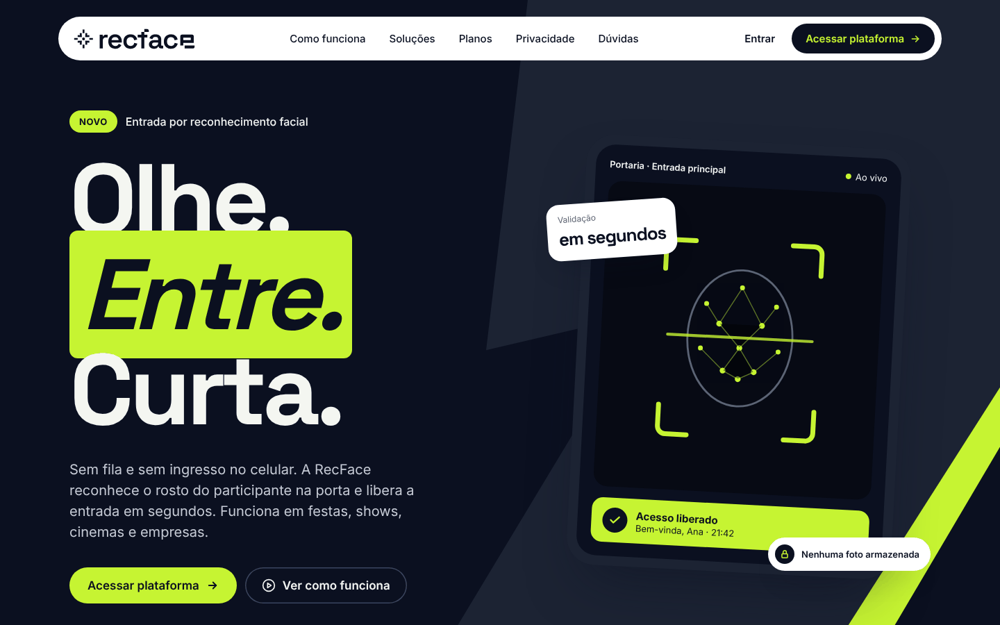
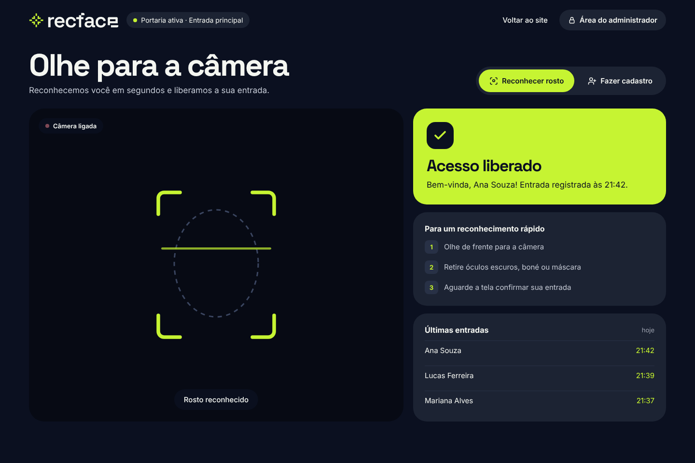
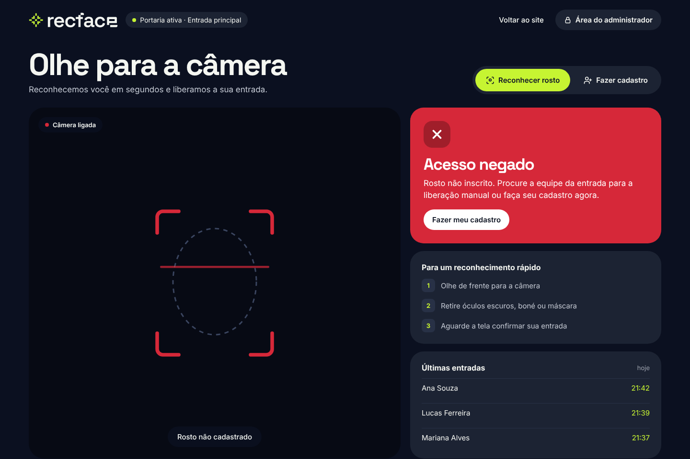
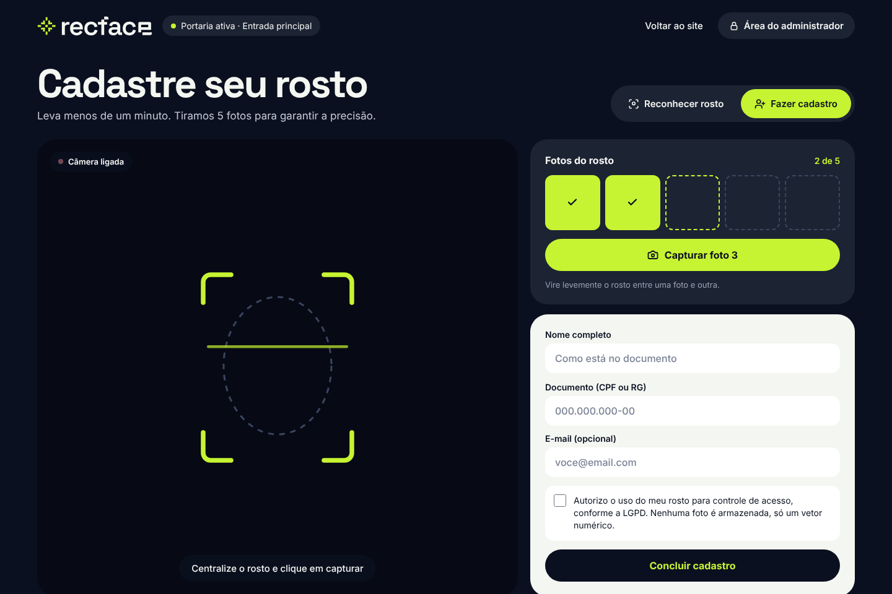
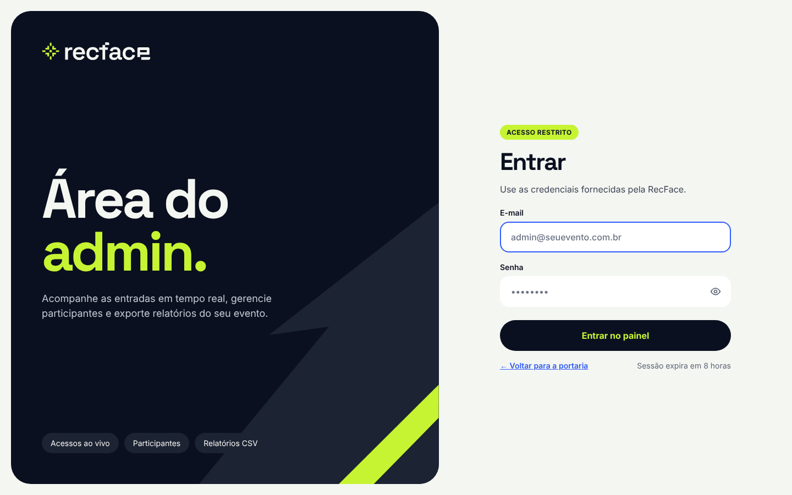
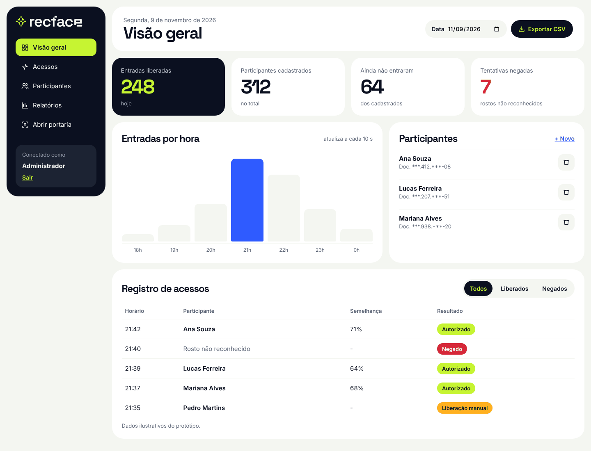
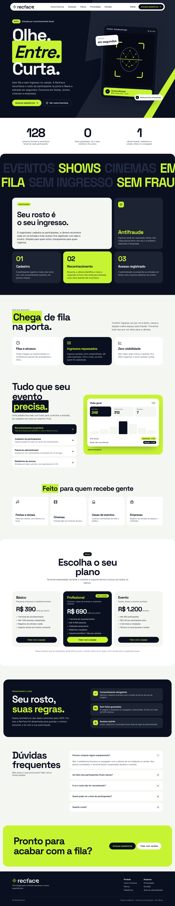
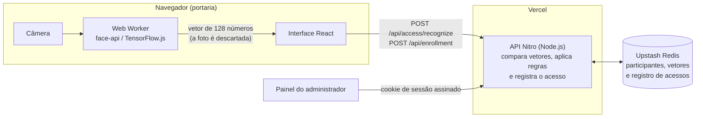

<p align="right">
  <a href="README.md"></a>
  <a href="README.pt-BR.md"></a>
</p>

<div align="center">

<picture>
  <source media="(prefers-color-scheme: dark)" srcset="public/brand/recface-logo-escuro.svg">
  
</picture>

### Olhe. Entre. Curta.

**Controle de acesso por reconhecimento facial, direto no navegador.**
Sem fila, sem ingresso no celular e sem guardar a foto de ninguém.

[](https://recface-umber.vercel.app)


</div>

<p align="center">
  
</p>

---

## Sumário

- [Sobre o projeto](#sobre-o-projeto)
- [Telas](#telas)
- [Funcionalidades](#funcionalidades)
- [Destaques técnicos](#destaques-técnicos)
- [Arquitetura](#arquitetura)
- [Stack](#stack)
- [Como rodar](#como-rodar)
- [Estrutura do projeto](#estrutura-do-projeto)
- [Limitações e próximos passos](#limitações-e-próximos-passos)
- [Equipe](#equipe)
- [Licença](#licença)

---

## Sobre o projeto

A **RecFace** é uma plataforma de controle de acesso para **eventos, festas, cinemas e empresas**.
O participante cadastra o rosto uma única vez; na entrada, basta olhar para a câmera. O sistema reconhece a
pessoa em segundos, libera o acesso e registra data e horário. O organizador acompanha tudo em um painel
administrativo ao vivo.

O projeto nasceu como Trabalho Acadêmico Integrado (TAI) do curso de **Ciência da Computação da PUC Minas**
e passou por duas versões:

| Versão | Contexto | O que mudou |
|---|---|---|
| **v1** (TAI 2) | Presença de alunos em laboratórios | Motor de reconhecimento no navegador, cadastro, painel e relatórios |
| **v2** (TAI 3) | Empresa RecFace: acesso a eventos | Site institucional, portaria com cadastro e reconhecimento, login de administrador, comparação facial no servidor, consentimento LGPD, nova identidade visual |
| **v2.1** | Desempenho e qualidade | Reconhecimento em Web Worker, modo quiosque (PWA), cache dos modelos, testes automáticos de interface e acessibilidade |

> **Privacidade por padrão:** a foto é analisada no próprio navegador e descartada. Só um vetor de 128 números,
> que não permite reconstruir a imagem do rosto, é enviado ao servidor.

---

## Telas

> Imagens do protótipo de alta fidelidade que guiou a implementação (os dados exibidos são ilustrativos).

### Portaria: reconhecimento e cadastro

| Acesso liberado | Acesso negado |
|---|---|
|  |  |

| Cadastro do rosto (5 fotos + termo LGPD) |
|---|
|  |

### Área do administrador

| Login | Painel |
|---|---|
|  |  |

<details>
<summary><b>Ver a página inicial completa</b></summary>
<br>

</details>

---

## Funcionalidades

**Para o participante**
- Cadastro guiado em menos de um minuto: 5 fotos do rosto, cada uma validada na hora, e aceite do termo da LGPD
- Reconhecimento na portaria em segundos, com resposta visual clara: **liberado**, **negado** ou **já entrou hoje**
- Se o rosto não for reconhecido, a tela oferece o cadastro na hora

**Para o organizador**
- Painel com entradas do dia atualizadas a cada 10 segundos e gráfico de entradas por hora
- Registro de **todas** as tentativas (liberadas, negadas, duplicadas e liberações manuais)
- Gestão de participantes: busca, liberação manual quando o reconhecimento falha e exclusão com apagamento do histórico
- Relatórios por período (7 dias, 30 dias ou datas escolhidas) com exportação em CSV

**Regras de negócio**
- Uma entrada por pessoa por dia (fuso de Brasília)
- Cadastro duplicado é recusado por documento **ou** por semelhança facial com alguém já cadastrado

---

## Destaques técnicos

| Desafio | Solução |
|---|---|
| **Privacidade dos dados biométricos** | Detecção e extração do vetor facial (128 dimensões) acontecem no navegador; nenhuma foto sai do aparelho nem é armazenada. |
| **Não expor a base de rostos** | Na v1 a página baixava os vetores de todos os cadastrados. Na v2 a comparação foi movida para o servidor (`POST /api/access/recognize`) e os vetores nunca saem dele. |
| **Interface travando durante a análise** | O reconhecimento roda em um **Web Worker** com `OffscreenCanvas`, fora da thread da interface. Cada quadro é reduzido para 640 px antes da análise. Há um *fallback* na página para navegadores sem suporte. |
| **Primeira análise lenta** | O aquecimento da GPU (~12 s) é feito durante o carregamento da página, antes do primeiro rosto aparecer. |
| **Modelos pesados (~12 MB)** | *Service worker* guarda os modelos e o build em cache; da segunda visita em diante a portaria abre sem baixar tudo de novo. |
| **Terminal de entrada** | Modo quiosque/PWA: app instalável, tela cheia e *Wake Lock* para a tela não apagar. |
| **Precisão x falsos positivos** | Mesma pessoa se a distância euclidiana entre vetores for ≤ 0,5; cadastro bloqueado se houver alguém a ≤ 0,42. O vetor cadastrado é a média de 5 capturas. |
| **Segurança do painel** | Sessão em cookie `httpOnly` assinado com HMAC-SHA256, válida por 8 horas; senha comparada em tempo constante; login desativado em produção sem credenciais configuradas. |
| **Qualidade e acessibilidade** | Testes *end-to-end* com Playwright em desktop e celular, incluindo verificação WCAG 2.1 AA com axe, respeito a `prefers-reduced-motion` e um teste de reconhecimento com câmera simulada. |

---

## Arquitetura



**Modelos de reconhecimento** (carregados de `public/models/`):
SSD MobileNet v1 (detecção) → Face Landmark 68 (pontos do rosto) → Face Recognition Net (vetor de 128 dimensões).

<details>
<summary><b>Rotas da API</b></summary>

| Método | Rota | Acesso | Função |
|---|---|---|---|
| GET | `/api/health` | público | Verifica se o servidor está no ar |
| POST | `/api/access/recognize` | portaria | Recebe o vetor facial, decide e registra o acesso |
| POST | `/api/enrollment` | portaria | Cadastro: nome, documento, e-mail, consentimento e vetor |
| POST | `/api/auth/login` · `/api/auth/logout` | público | Entrar / sair |
| GET | `/api/auth/me` | admin | Sessão atual |
| GET | `/api/access/date/:data` | admin | Todas as tentativas de uma data |
| GET | `/api/students` · `/api/students/:id` | admin | Participantes (sem dados faciais) |
| DELETE | `/api/students/:id` | admin | Exclui participante e histórico |
| POST | `/api/attendance/register` | admin | Liberação manual da entrada |

</details>

---

## Stack

| Camada | Tecnologias |
|---|---|
| **Front-end** | React 19, TypeScript, TanStack Start / Router, Tailwind CSS 4, shadcn/ui (Radix), Recharts |
| **Visão computacional** | @vladmandic/face-api sobre TensorFlow.js, em Web Worker |
| **Back-end** | Nitro (Node.js), rotas de API por arquivo |
| **Banco de dados** | Upstash Redis via @vercel/kv |
| **PWA / Quiosque** | Web App Manifest, Service Worker, Fullscreen API, Wake Lock API |
| **Testes** | Playwright (desktop + celular) e @axe-core/playwright |
| **Build e deploy** | Vite 7, Bun, Vercel (deploy contínuo a cada push na `main`) |

---

## Como rodar

**Pré-requisitos:** [Bun](https://bun.sh) instalado (o `npm install` falha por conflito de *peer dependencies*).

```bash
git clone https://github.com/cxrlos99leonel/RecFace.git
cd RecFace
bun install
bun run dev
```

Sem variáveis de ambiente, os dados ficam em memória e vale um login de teste **somente local** para o painel:
`admin@recface.local` / `recface123`. Esse acesso fica desativado em produção.

**Testes de interface e acessibilidade**

```bash
bun run build
bun run test:e2e
```

**Variáveis de ambiente (produção)**

| Variável | Uso |
|---|---|
| `KV_REST_API_URL` · `KV_REST_API_TOKEN` | Conexão com o Upstash Redis |
| `ADMIN_EMAIL` · `ADMIN_PASSWORD` | Credenciais do administrador |
| `ADMIN_SESSION_SECRET` | Opcional: segredo para assinar a sessão |

> A câmera exige HTTPS (ou `localhost`) e permissão do navegador.

---

## Estrutura do projeto

```
src/
  routes/        páginas: site (/), portaria (/plataforma), login e painel (/admin)
  components/    marca, navegação, componentes do painel e de interface (shadcn/ui)
  lib/           câmera, reconhecimento (worker + fallback), API, modo quiosque
server/
  routes/api/    rotas da API, um arquivo por rota
  lib/           Redis, autenticação, regras de acesso, datas
public/
  models/        pesos dos três modelos de reconhecimento
  brand/         logos e símbolo da RecFace
tests/e2e/       testes Playwright + axe
docs/prototipo/  imagens do protótipo usadas neste README
```

Detalhes completos de arquitetura, regras de negócio e histórico em
[`CONTEXTO-DO-PROJETO.md`](CONTEXTO-DO-PROJETO.md).

---

## Limitações e próximos passos

- [ ] **Prova de vivacidade** (*liveness*): hoje uma foto do rosto diante da câmera pode ser aceita
- [ ] **Múltiplos eventos** por organizador (a versão atual trata um único local/evento)
- [ ] **Limite de requisições** (*rate limiting*) nas rotas públicas
- [ ] **Migração para Vite 8** e versões mais novas do TanStack Start
- [ ] Portaria aberta por design: em uso real, o terminal deve ficar sob supervisão da equipe
- [ ] Precisão cai com iluminação ruim, rosto de perfil ou óculos escuros

---

## Equipe

Projeto desenvolvido em equipe no curso de Ciência da Computação da **PUC Minas**.

**Integrantes:** Carlos Eduardo Divino Souza Leonel · Henrique Rodrigues Martins · João Vitor Garçon dos Reis ·
Jonas Henrique Teixeira · Luis Augusto de Oliveira Bordin

**Orientadores:** Diego Roberto Gonçalves de Pontes · Udo Fritzke Junior · Will Ricardo dos Santos Machado

---

## Licença

© 2026 Equipe RecFace. **Todos os direitos reservados.** O código está público apenas para fins de portfólio e
avaliação acadêmica: pode ser lido, mas não copiado, modificado, distribuído ou usado sem autorização por escrito.
Veja [`LICENSE`](LICENSE) e a [política de segurança](SECURITY.md).

---

<div align="center">
  <sub>Tecnologia para conectar pessoas a novas experiências.</sub>
</div>
